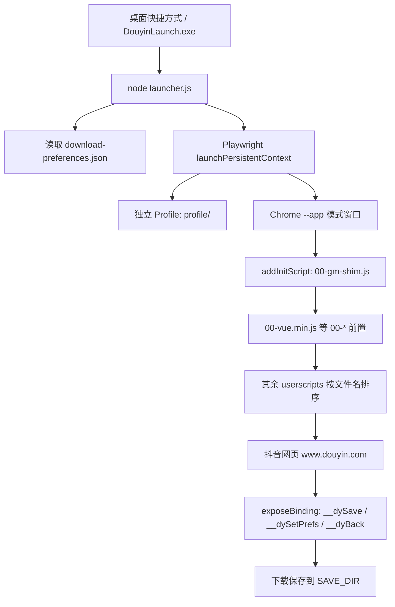

# 架构

## 启动链路

## 关键事实（对照代码核实）

- **入口**：`launcher.js`（Node 脚本）。`DouyinLaunch.exe` 只是启动器壳，指向 `node launcher.js`。
- **浏览器**：`chromium.launchPersistentContext(PROFILE, { channel:'chrome', args:['--app=...','--start-maximized', ...] })`。
- **无地址栏**：靠 `--app=` 打开空白页再 `goto` 抖音；不是独立 kiosk。
- **Profile**：`%LOCALAPPDATA%\DouyinApp\profile`，持久化登录态，**不可打包分发**。
- **脚本加载顺序**：`scriptList()` 读 `userscripts/*.js` 排序；`00-*` 与 `@run-at document-start` 归入早批，其余合并成一个 `DOMContentLoaded` 后执行的块。`.bak` / `.disabled` / `.txt` 不会被加载。
- **脚本依赖**：10/11/12/13/15 依赖 `00-gm-shim.js` 提供的 GM_* 与 `00-vue.min.js` 的 Vue。
- **配置读写**：`download-preferences.json`，六个布尔键，读写失败回退默认值。
- **下载路径**：`SAVE_DIR`（默认 `D:\Media\Douyin`，自动创建）。
- **日志**：`launcher.log`，记录媒体请求、主框架导航、`[life] document load`、页面 `[DouyinSave]` 控制台输出与错误（错误最多 40 条）。
- **错误处理**：注入包裹 `try/catch`，单脚本失败不影响其他脚本；下载任务按 `task_id` 落日志，解析结果 id 不匹配即中止。
- **退出**：关闭窗口 → `ctx.on('close')` → `process.exit(0)`。
