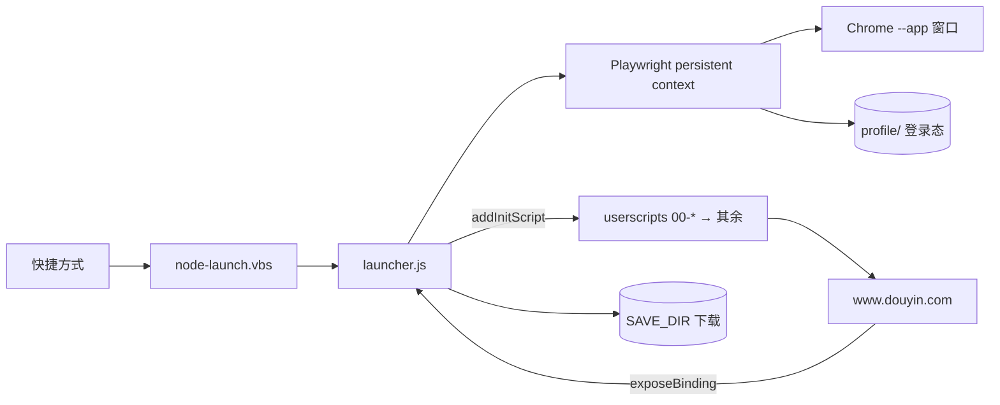

# PROJECT_STATE — 未来接手者的第一入口

> 读这一份就够了；需要细节再跳 docs/。**不要重复调查已经有结论的问题，不要擅自回滚已完成的改动。**

## 1. 这是什么

把抖音网页版包装成独立桌面应用的启动器：独立 Chrome Profile、无地址栏窗口、按序注入用户脚本、内置下载面板。不是官方客户端，不碰抖音服务端。

## 2. 架构

## 3. 当前稳定版本

| 项 | 值 |
|---|---|
| 版本 | 1.0.0（2026-11-25） |
| Git | https://github.com/yloong0116-png/douyin-web-desktop （branch: main） |
| launcher.js | `c1160d8fd56d0b9598c000cf38844124d82aae75e0eb9a3b6a599df260f1b080`（**交付副本**因路径可配置化而不同，见 FILES_SHA256） |
| nav.js | `374c8bb8329b92e0ebd4eb7371f374979cd067e2b1b538669a5d1893886ed605`（原版） |
| 12-douyinplus | `99afa17b91a94887e5ee399d0e2ce5548963c9836beade2246220503c4d66415`（未打包，仅记录） |
| 启用脚本 | 00-gm-shim, 00-vue, 10, 11, 15, 16, 17, 18, 20(默认关) |
| 停用脚本 | 14-dydl(`.disabled`), 12/13(未打包) |
| 配置 | `download-preferences.json`（模板：`app/config/download-preferences.example.json`） |

## 4. 已完成

| 工作 | 文件 | 验证 |
|---|---|---|
| 启动器 + 独立 Profile + 注入顺序 | launcher.js | 多次冷启动，日志可查（已实测） |
| 下载面板 + 六类选择 + 偏好落盘 | 16-save-video.js, launcher.js | 面板挂载与偏好实测；逐项下载未测 |
| 导航隐藏 4 项、保留 6 项原生样式 | 17-glass-nav.js | `hidden=4`（已实测） |
| 隐藏 SmartFeed 悬浮球 | 18-hide-assistant.js | 注入生效（已实测） |
| 路径可配置化（交付副本） | app/launcher/launcher.js | 见 manifests/FILES_SHA256.txt |

## 5. 未解决问题（按优先级）

1. **返回上一页整页重载**（P0）。已证实是跨文档 Document 请求；bcase 被站点 `no-store` 拒绝；候选补丁实测无效。缺一块证据：真实登录态下从推荐流点作者是否 SPA。
2. 六类下载逐项回归（P1）。
3. 倍速/画质在抖音改版后的可用性（P1）。
4. 无 UI 自动化回归（P2）。

## 6. 不要再踩的坑

- 不要用 DOM 强改去压缩左侧布局 → 触发 ResizeObserver，节点重建抖动。
- 不要把左侧导航 DIV 当链接点：它没有 `href`，`.click()` 与 CDP 指针都无效。
- 不要用 `load` 事件判断整页刷新 —— bfcache 恢复也会重发。
- 不要用单次采样给某个脚本扣性能帽子。
- 不要拿正式 Profile 做实验（会污染登录态）。
- 不要在未验证下改启动参数（`--disable-back-forward-cache` 已验证移除无用）。
- 不要覆盖 `backups/DouyinApp-v3.1-stable`。
- 不要把 `.txt` 候选补丁改成 `.js` 塞进 userscripts。

## 7. 接手顺序

1. `README.md` → 2. `docs/ARCHITECTURE.md` → 3. `docs/FEATURES.md` → 4. `docs/KNOWN_ISSUES.md` → 5. 本文件

**先读现状，再动手。**

## 8. 2026-11-25 更新

- `16-save-video.js` → v3.2：统一作品识别（URL modal_id / href 兜底 / 浮层作用域 / 优先级裁决 / 冲突拒绝）。
- 已实测：详情页、他人主页浮层、自己主页浮层、搜索页浮层 4 类锁定正确；无作品页正确拒绝。
- 未验证：推荐页、关注页、朋友页（测试实例不渲染作品标识）。
- 回滚：`userscripts/16-save-video.v3.1-20261124.bak`（sha `8bbc20f4…`）。

## 9. 2026-11-25 续修（v3.3）

- 串号根因：推荐流容器 `data-e2e-vid` 滞留 + `lastClick` 跨路由有效。
- 修复：路由隔离（path 变化清空）、href 优先、只收播放中且 30% 可见的播放器、无权威来源冲突即拒。
- 待人工验证：关注页/朋友页真实下载。
- 回滚：`userscripts/16-save-video.v3.2-20261125.bak`（sha `f3c982fa…`）。

## 10. 2026-11-25 收尾（v1.0.3）

- **下载 P0 关闭**：v3.3（`8b13f7d0…`）经用户在正式应用内确认，关注页/朋友页可正常下载；自动化侧已验证详情页/主页浮层/搜索浮层锁定正确、无作品页正确拒绝。**用户确认级证据，非独立文件级逐项校验**。
- 稳定版本：v3.3（`16-save-video.js`），回滚备份 `16-save-video.v3.2-20261125.bak` / `.v3.1-20261124.bak` 均保留。
- 导航返回问题**未解决**，`nav.js` 保持原版，候选补丁未启用。
- 交付包 v1.0.3 见 `releases/`。
