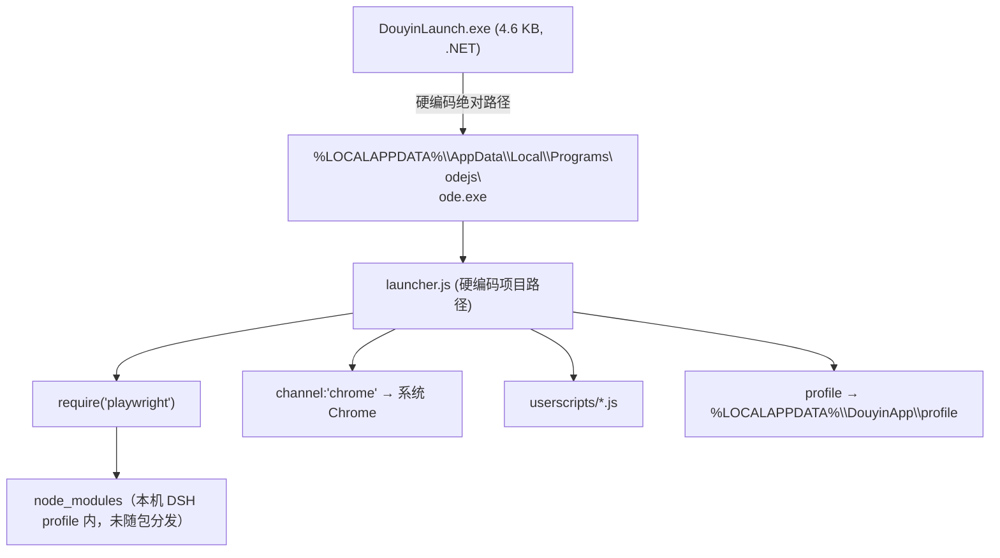

# 便携化审计报告（portable_audit）

日期：2026-11-25　基线：Douyin-Web-Desktop 1.0.3（功能 v3.3）
结论：**当前交付包不具备便携性**，需重新打包运行时与浏览器，并替换启动器。本文仅为审计，未修改任何运行代码。

---

## 1. 现状架构

## 2. 实测证据（只读）

| 项 | 实测结果 |
|---|---|
| `DouyinLaunch.exe` | 4,608 B，.NET v4.0.30319 编译的 stub；UTF-16 字符串里写死三条绝对路径：`%LOCALAPPDATA%\AppData\Local\Programs\nodejs\node.exe`、`%LOCALAPPDATA%\AppData\Local\DouyinApp\launcher.js`、`…\launcher.log` |
| 项目内 `node_modules` | **不存在** |
| 交付 ZIP | 46 条目，**无 `.exe`、无 `node_modules`、无 `browser/`、无 `runtime/`** |
| `launcher.js` 首行 | `require(process.env.DY_PLAYWRIGHT \|\| 'playwright')` → 依赖外部模块 |
| 浏览器 | `channel: 'chrome'` → 必须系统已装 Chrome |
| 硬编码路径残留 | `app/` 下无 `<user>` / `<工作区>`（此项已干净） |

## 3. 依赖与体积

| 组件 | 版本 | 现有位置 | 体积 |
|---|---|---|---|
| Node.js | v22（本机） | `%LOCALAPPDATA%\Programs\nodejs` | node.exe 单文件约 80–110 MB |
| playwright | 1.65.0 | DSH profile node_modules | 5.0 MB |
| playwright-core | 1.65.0 | 同上 | 14 MB |
| Chromium | build 1254 | `%LOCALAPPDATA%\ms-playwright` | 全量 742 MB；**仅 chrome-win 约 150–180 MB 可用** |
| app + userscripts + 文档 | — | 交付目录 | ~1 MB |

## 4. 不便携的具体原因

1. **启动器写死本机 node 路径与项目路径** —— 换电脑/换目录必然失败，这是第一硬伤。
2. **未捆绑 Node 运行时** —— 目标机没有 node 就完全跑不起来。
3. **未捆绑 Playwright** —— `require('playwright')` 无处可解。
4. **未捆绑 Chromium** —— 依赖系统 Chrome（且版本要够新）。
5. **用户数据写进程序目录** —— `profile/`、`launcher.log` 落在安装目录，升级覆盖容易丢登录态（当前 1.0.3 已把 `profile` 放项目根，正好违反便携要求）。

## 5. 必须修改的文件

| 文件 | 改动 |
|---|---|
| `DouyinLaunch.exe` | 重新编译：读自身目录 → 启动 `runtime\node.exe app\launcher.js`，隐藏控制台，失败弹 MessageBox（附日志路径），单实例互斥 |
| `app/launcher/launcher.js` | 路径全部改为"以 exe 目录为根"；`require(相对 playwright)`；`executablePath` 指向 `browser\chrome-win\chrome.exe`（保留 channel 回退）；`PROFILE`/`LOG`/配置移到 `%LOCALAPPDATA%\DouyinWebDesktop\`；单实例保护 |
| 新增 `runtime/` | `node.exe`（单文件）+ `node_modules/playwright{,-core}` |
| 新增 `browser/` | Chromium build 1254 的 `chrome-win`（去掉 headless shell / ffmpeg） |
| `README.txt` / `VERSION.txt` / `SHA256SUMS.txt` | 面向普通用户 |

**不改**：`nav.js`、`16-save-video.js`、`17-glass-nav.js`、`18`、`20`、`15`、`10`、`11`、`00-*` 的**功能逻辑**（仅路径解析层适配）。

## 6. 可选优化

- 只带 `chromium-1254` 的 `chrome-win`，删 `chrome-win` 里的 `*.pdb`、`swiftshader`（若不需要 WebGL 软渲染）。
- 用 7z 的 LZMA 压缩（比 zip deflate 小 20–30%），但普通用户解压体验略差 —— 建议仍用 ZIP。
- 启动器加"检测到已在运行就聚焦已有窗口"。

## 7. 预计交付体积

| 组成 | 未压缩 | ZIP 后 |
|---|---|---|
| node.exe | 80–110 MB | 30–40 MB |
| playwright + core | 19 MB | 6 MB |
| chromium chrome-win | 150–180 MB | 55–70 MB |
| app/文档 | 1 MB | 0.3 MB |
| **合计** | **约 250–310 MB** | **约 90–120 MB** |

## 8. 最小改造方案（分三步，均可回滚）

**步骤 1：启动器（无 Node 环境也能跑）**
写 `Launch.cs`（约 60 行）：取 `AppDomain.CurrentDomain.BaseDirectory` → 拼 `runtime\node.exe` 与 `app\launcher.js` → `Process.Start`（`CreateNoWindow`、工作目录=exe 目录）→ 失败 MessageBox 显示 `%LOCALAPPDATA%\DouyinWebDesktop\launcher.log` 路径 → 用 `Mutex` 做单实例。
用系统自带 `C:\Windows\Microsoft.NET\Framework64\v4.0.30319\csc.exe` 编译，**目标机无需 .NET SDK**（Win11 自带 .NET Framework 4.8）。

**步骤 2：launcher.js 路径层**
新增 `PORTABLE` 判定：若 `runtime\` 存在则用它；否则退回旧行为。
- `PLAYWRIGHT_PATH = <root>\runtime\node_modules\playwright`
- `PROFILE = %LOCALAPPDATA%\DouyinWebDesktop\profile`
- `LOG = %LOCALAPPDATA%\DouyinWebDesktop\launcher.log`
- `SAVE_DIR = %LOCALAPPDATA%\DouyinWebDesktop\Downloads`（**待确认**，见第 10 节）
- `executablePath = <root>\browser\chrome-win\chrome.exe`（不存在则 `channel:'chrome'`）

**步骤 3：打包**
目录结构 `DouyinLaunch.exe / runtime/ / browser/ / app/ / README.txt / VERSION.txt / SHA256SUMS.txt`，从任意路径解压运行；校验哈希后出 ZIP。

## 9. 风险

| 风险 | 说明 |
|---|---|
| 杀软误报 | 便携 node.exe + 自编译 exe + 自动启动浏览器，容易被 Defender 启发式拦；需在 README 写清 |
| Playwright ↔ Chromium 版本必须配对 | 1.65.0 ↔ build 1254，混版会报 "Executable doesn't exist" |
| 体积 | 100 MB 级，下载/解压需要时间 |
| 便携 node 的路径限制 | node.exe 必须在 `runtime\` 内、不能用 8.3 短路径外的情况；含中文/空格的路径已在方案里用 BaseDirectory 处理，但**未实测** |

## 10. 待你决定的两点

1. **下载文件去哪**：任务要求放 `%LOCALAPPDATA%\DouyinWebDesktop\`，但你现有的习惯是 `D:\Media\Douyin`（记忆里的默认）。便携包里改成前者会改变现有使用方式。
   - 选项 A：`%LOCALAPPDATA%\DouyinWebDesktop\Downloads`（符合任务书）
   - 选项 B：保持 `D:\Media\Douyin`（沿用现状，可在配置里改）
2. **是否允许重编译 `DouyinLaunch.exe`**：会用系统自带 csc 生成新的 4 KB 启动器，原 exe 备份保留。不重编译就只能让用户手动改，或改用 `.bat`（体验差）。

## 11. 未验证项

- 无 Node 环境的真机运行（本机装有 node，无法模拟）
- 含中文/空格路径启动（方案设计已考虑，未实测）
- 便携 Chromium 与 Playwright 1.65 的配对（本机 ms-playwright 里的 1254 是同一 build，理论一致，未在隔离目录验证）
- 异机部署（无第二台机器）
